


  

## Sobre mim

Comecei em 2014 no suporte de TI e, em 2022, passei para o desenvolvimento, criando sites em WordPress como autônomo. Depois vieram Laravel, Angular e React.

Hoje sou Desenvolvedor Web na AGT Online, onde cuido de sites em produção: melhorias, correções, backups e rotinas de segurança. Nos projetos novos da Elege Softhouse, trabalho com TypeScript de ponta a ponta, com Fastify, PostgreSQL e Next.js.

Meu foco está em PHP/Laravel, WordPress e aplicações web escaláveis. Moro em Minas Gerais e curso Ciência da Computação na Descomplica.

## Tecnologias

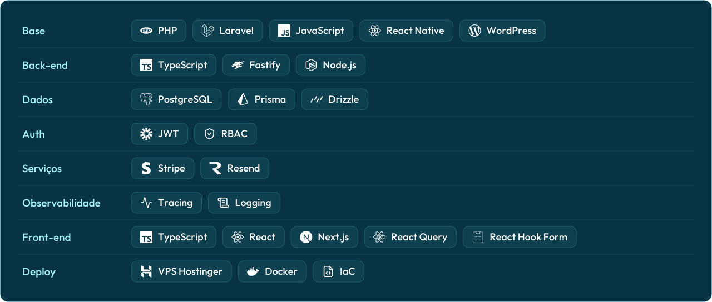

## Projetos

  <a href="https://elegegroup.com/">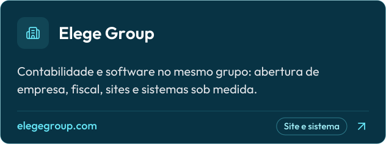</a>
  
  <a href="https://axiomatax.com.br/">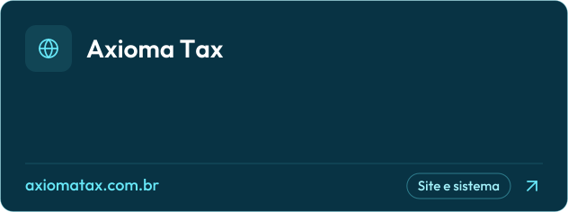</a>
  <a href="https://hub2000.com.br/">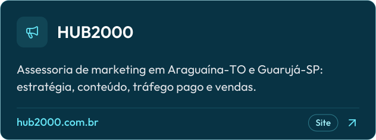</a>
  
  
  <a href="https://motoara.com.br/">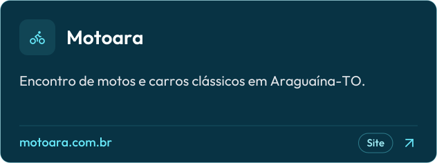</a>
  <a href="https://restaurarrelacionamentos.com.br/">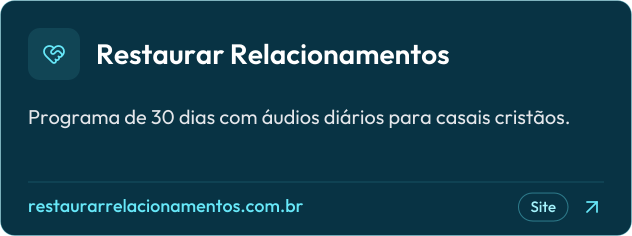</a>

## GitHub

  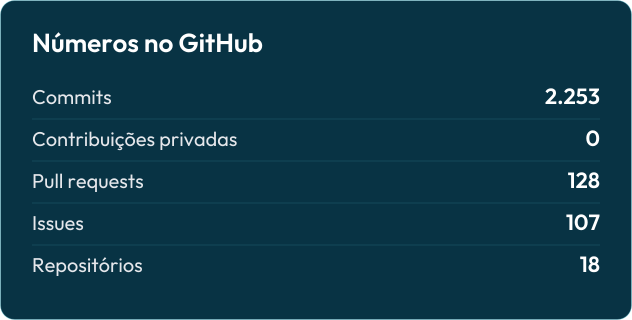
  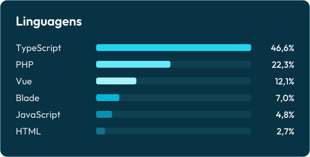

  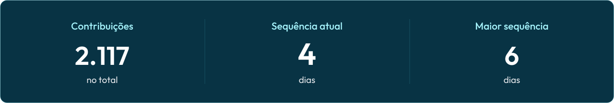

  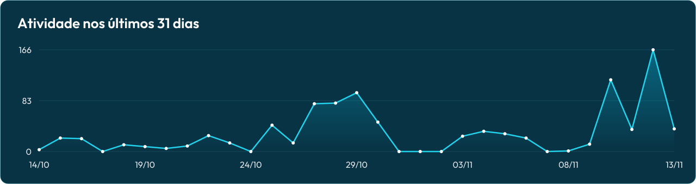

  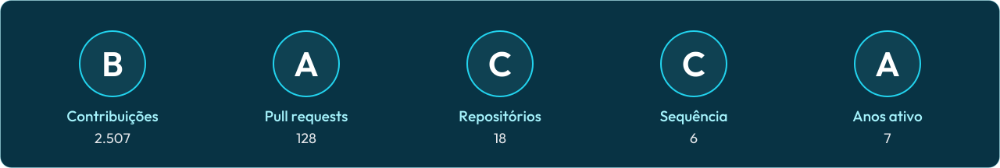

  <picture>
    <source media="(prefers-color-scheme: dark)" srcset="https://raw.githubusercontent.com/gabrielgws/gabrielgws/output/github-snake-dark.svg" />
    
  </picture>

## Redes sociais

  
  
  
  
  

 

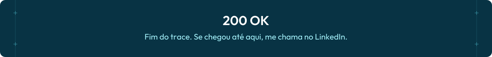
